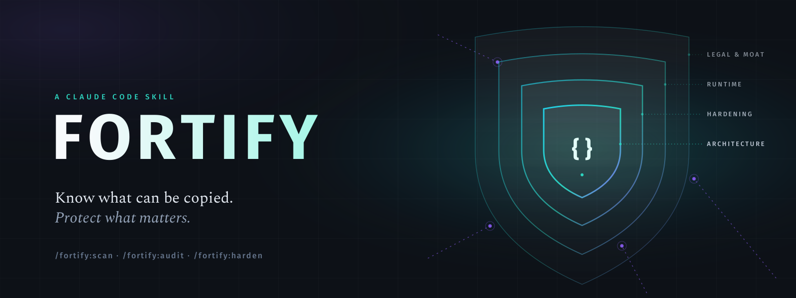

<p align="center">
  
</p>

<h1 align="center">Fortify</h1>

<p align="center">
  <b>Find out how easily your product can be reverse engineered, cracked, scraped or cloned —<br/>
  then get a protection plan in plain language, and apply it.</b>
</p>

<p align="center">
  
  
  
  
  
</p>

---

## Why this exists

Months of work can now be rebuilt in days. In October 2026 a developer released free, open-source rebuilds of seven Adobe apps made with AI help — and **no Adobe code was decompiled**: they were rebuilt from public specs and observed behaviour. That changes what "protecting your product" means.

Most developers have never heard of *obfuscation*, *app attestation* or *clean-room reimplementation*, and the protection tools are scattered across a dozen platforms. Fortify packs that knowledge into one Claude Code skill: it looks at **your** product, tells you honestly where it's exposed, and proposes the protections that fit your stack, budget and risk — explained so anyone can decide.

It is honest about the limits: nothing that runs on a machine an attacker controls is uncrackable. Fortify raises the cost of copying where it matters, keeps your crown jewels off the client, and helps you build the things a clone can't copy.

---

## What it does

```
/fortify:scan   →   /fortify:audit   →   review the plan   →   /fortify:harden
```

- **`/fortify:scan [path]`** — a quick, **read-only** pass. Detects your stack and flags what makes copying easy: published source maps, secrets in client code, paid-feature checks on the device, AI keys in the browser, unobfuscated release builds, missing rate limits, and more. Every finding comes with what it means in plain words and the fix.
- **`/fortify:audit [path] [notes]`** — the full assessment. Reads the code, asks a few questions only where the code can't answer, rates the **five ways products get copied**, assesses your **moat**, and writes `protection-assessment.md` with a numbered, tiered plan. Changes nothing.
- **`/fortify:harden [items]`** — applies the items you pick (`T1-1 T2-3`, or `all-tier1`) as small, explained changes, rebuilding and testing after each, then re-scans to show before/after.

You can also just ask: *"how exposed is this app to being cloned?"* — the skill activates on its own.

### The five clone vectors

| Vector | The question |
|---|---|
| **Code extraction** | Can someone decompile or read the shipped code and lift the logic? |
| **Behavioural cloning** | Can someone rebuild it from the outside — using it, reading docs, with AI help? |
| **Data & API harvesting** | Can someone scrape the data, hammer the API, or distil the AI model? |
| **Piracy & tampering** | Can someone unlock paid features or run a modified client? |
| **Secret & asset leakage** | Are keys, prompts, weights or paid assets shipped to the client or committed? |

### The plan, in tiers

| Tier | Effort | Typical items |
|---|---|---|
| **1 — Quick wins** | hours, free | Turn off public source maps · move secrets server-side and rotate them · enable release minification · add rate limits · register the trademark |
| **2 — Core protection** | days | Move crown-jewel logic to the server · server-side paid-feature checks · platform obfuscation · Play Integrity / App Attest · signed licences · per-customer watermarks · data trap records · clone monitoring |
| **3 — Advanced** | weeks, often paid | Code virtualization · commercial RASP / anti-tamper · hardware-bound licensing · patents — only when the stakes justify it |

Every recommendation says **what** it is, **why** it applies, **how** to do it on your stack, what it **costs**, and **how much it really helps**.

### Covered platforms

Web front-ends · Node.js · Android · iOS · React Native · Flutter · Electron · .NET · Java/JVM · C / C++ / Rust / Go · Python · Unity / Unreal / Godot · APIs & SaaS · data products · AI / LLM products — plus a legal primer (EU & Portugal, US) and a plain-language glossary.

---

## Install

This repo is both the **skill** and a **plugin marketplace** that serves it. Pick whichever fits.

### 1. As a plugin, via the marketplace — recommended

Installs the skill **and** the three commands, and keeps them updatable:

```
/plugin marketplace add nunoamorim99/fortify
/plugin install fortify@nunoamorim99-fortify
```

The commands appear in the `/` menu as `/fortify:scan`, `/fortify:audit` and `/fortify:harden`. Update later with `/plugin marketplace update nunoamorim99-fortify`.

**Team-wide (project scope):** commit this to the project's `.claude/settings.json` so everyone who opens the project gets Fortify:

```json
{
  "extraKnownMarketplaces": {
    "nunoamorim99-fortify": {
      "source": { "source": "github", "repo": "nunoamorim99/fortify" }
    }
  },
  "enabledPlugins": {
    "fortify@nunoamorim99-fortify": true
  }
}
```

### 2. As a skill only — manual

Copy the skill folder into your skills directory (project-level `.claude/skills/`, or `~/.claude/skills/` for all projects):

```bash
cp -r plugins/fortify/skills/fortify ~/.claude/skills/
```

Then just describe what you want ("assess how exposed this app is to cloning") — the skill activates on its own.

### 3. Add the slash commands — optional

To get `/scan`, `/audit` and `/harden` without the plugin, drop the command files in too:

```bash
mkdir -p .claude/commands && cp plugins/fortify/commands/*.md .claude/commands/
```

### 4. On claude.ai or the Claude app

Download **[`dist/fortify.zip`](dist/fortify.zip)** and upload it in **Settings → Capabilities → Skills**. Then ask Claude to assess your product, or type `/fortify`.

---

## Requirements

Claude Code (or claude.ai with skills enabled). The scanner needs only **Python 3.8+** and the standard library — no installs. It is read-only, skips dependencies and build caches, and **masks every secret it finds** (first four characters only), so a full key never lands in the chat or the report.

## What Fortify won't do

- **Promise the impossible.** No "uncrackable" claims — every measure is rated by how much it really helps, and against whom.
- **Attack anyone.** It's defensive only: it assesses *your* product, never helps crack or copy someone else's.
- **Punish users or crackers.** No destructive "booby-trap" code, no spyware-style telemetry, no hack-back — those are illegal in most places. Tamper telemetry must respect GDPR and be disclosed.
- **Pretend to be a lawyer.** The legal section is general information; for registrations or disputes, talk to an IP lawyer.

> The assessment names real weaknesses in your product. Keep `protection-assessment.md` out of public repositories.

## Repository layout

```
.
├── .claude-plugin/
│   └── marketplace.json              # marketplace catalog "nunoamorim99-fortify" (source: ./plugins/fortify)
├── plugins/fortify/
│   ├── .claude-plugin/plugin.json    # plugin manifest
│   ├── skills/fortify/               # THE SKILL — self-contained
│   │   ├── SKILL.md                  # workflow, modes, guardrails
│   │   ├── references/               # platforms · glossary · legal · report template
│   │   ├── scripts/scan.py           # stack detection + exposure scanner (stdlib only)
│   │   └── docs/                     # skill README, cover, cover prompts
│   ├── commands/                     # scan.md · audit.md · harden.md
│   └── README.md
├── dist/fortify.zip                  # drop-in skill bundle for claude.ai upload
├── assets/                           # cover for this page (+ its generator)
├── LICENSE
└── README.md
```

Single source of truth: the skill lives once, at `plugins/fortify/skills/fortify/`. Every install route reads from that one copy; `dist/fortify.zip` is built from it.

## Part of a suite

Fortify is one of Nuno Amorim's Claude Code skills, alongside **[Cartographer](https://github.com/nunoamorim99/cartographer)** (stakeholder documentation generated from your repositories).

## License

[MIT](LICENSE) © 2026 Nuno Amorim. Cover typography: **Fira Sans** (© The Mozilla Foundation & Telefónica) and **Spectral** (© Production Type), SIL Open Font License 1.1.
