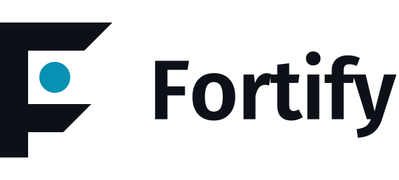

<p align="center">
  <picture>
    <source media="(prefers-color-scheme: dark)" srcset="docs/assets/logo/fortify-horizontal-color-dark.svg">
    
  </picture>
</p>

# Fortify — skill reference

Fortify assesses how exposed a software product is to being copied and builds a protection plan that fits it. This page documents how the skill works; installation is in the [repository README](../../../../README.md).

---

## How a run works

```
intake  →  scan  →  assess 5 vectors + moat  →  tiered plan  →  report  →  (harden)
```

1. **Intake.** Reads the codebase first, then asks at most 3–4 questions the code can't answer: how the product reaches users, what the crown jewels are, who the threat is, budget and constraints. If nobody is there to answer, it states its assumptions at the top of the report and carries on.
2. **Scan.** Runs `scripts/scan.py` (read-only, standard library only) and confirms every finding by opening the file — findings are leads, not verdicts.
3. **Assess.** Rates the five clone vectors High / Medium / Low (exposure × value × ease) and assesses the moat: what a clone could *not* copy.
4. **Plan.** Architecture first ("what can move to the server?"), then three tiers. Each item: what, why, how on your stack, cost / trade-off, and how much it really helps.
5. **Report.** `protection-assessment.md` in the project root, in your language, every recommendation numbered (T1-1, T2-3 …), with a glossary of the terms it uses.
6. **Harden** (only when asked). Small, explained changes; build and tests after each; secrets moved out of the client must be rotated; re-scan with before/after.

## Modes

| Mode | Plugin command | Steps | Writes |
|---|---|---|---|
| scan | `/fortify:scan` | 2 | nothing |
| audit | `/fortify:audit` | 1–5 | `protection-assessment.md` |
| harden | `/fortify:harden` | 6 | code and build config |

Asking in plain words ("how easy would it be to clone this app?") runs an audit.

## What the scanner checks

| Area | Checks |
|---|---|
| **Stack detection** | Web front-end, Node/Python/Rust/Go/.NET servers, Android, iOS, React Native, Flutter, Electron, .NET desktop, JVM, Rust, Go, Python, PyInstaller, Unity, Unreal, Godot, C/C++ |
| **Code extraction** | Source maps in build output · source maps enabled in Vite / webpack / Next.js / CRA config · Android release without R8 · Flutter builds without `--obfuscate` · .NET shipping plain IL · Unity on Mono · Electron with asar off · Rust release keeping symbols · PyInstaller-only Python · AI prompts embedded in client code |
| **Secret & asset leakage** | Known key formats (AWS, Stripe live, GitHub, OpenAI, Anthropic, Google, Slack, SendGrid, private key blocks) in source *and* build output · secret-looking assignments · secrets behind public env prefixes (`VITE_`, `NEXT_PUBLIC_`, `REACT_APP_` …) · AI SDKs in client code · `dangerouslyAllowBrowser` · `.env` files not ignored · Android `allowBackup` |
| **Piracy & tampering** | Paid-feature checks in client code · debuggable Android releases · no app attestation / RASP on mobile · Electron without fuses |
| **Data & API harvesting** | Server code without rate limiting |
| **Legal** | Project licence, with the copyleft-vs-obfuscation caveat |

Output is a plain-language summary plus optional JSON (`--json`). Secrets are always masked (first four characters + length). On a 28,000-file tree the scan takes about 10 seconds.

```bash
python3 scripts/scan.py <project-root> --json /tmp/fortify-scan.json
```

**It can't see** behavioural cloning, how valuable your data is, or your business moat — that's what the audit's assessment step is for.

## Reference files

| File | What's in it |
|---|---|
| `references/platforms.md` | Per platform: what an attacker extracts, and the tools and settings that protect it — free options first |
| `references/glossary.md` | One-line, plain-language definitions of every term a report may use |
| `references/legal.md` | Copyright, trademark, design rights, patents, trade secrets, EU database right, contracts; EU/Portugal and US specifics; takedown routes |
| `references/report-template.md` | Structure of `protection-assessment.md` |

Tool names and prices change. The skill checks the current status of paid or niche tools before recommending them.

## Design principles

- **Honesty over reassurance.** Protection raises the cost of copying; it never makes it zero.
- **Code is rarely the real target anymore.** AI makes behavioural cloning cheap, so the moat is always assessed alongside the code.
- **Architecture beats tricks.** Code that never ships can't be decompiled.
- **Plain language.** Every technical term is explained the first time it appears.
- **Proportionality.** A side project doesn't need Denuvo.
- **Defensive only.** Your product, never someone else's; nothing that harms users or attackers.

## Cover art

`docs/assets/logo/` holds the logo lockups shown at the top (dark and light). `docs/assets/cover.png` is the designed cover, kept as the social preview. `docs/cover-prompts.md` has Higgsfield prompts for marketing variants in the suite's style.
